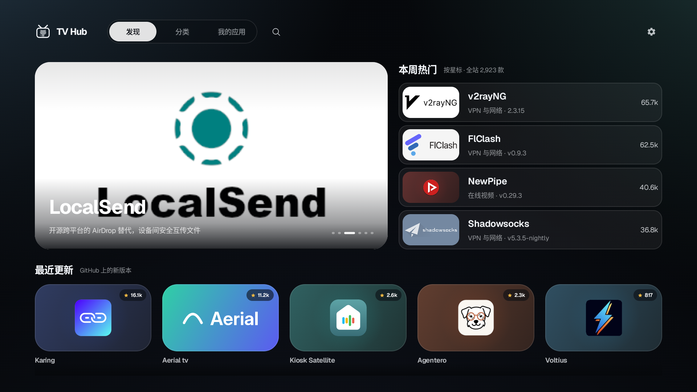
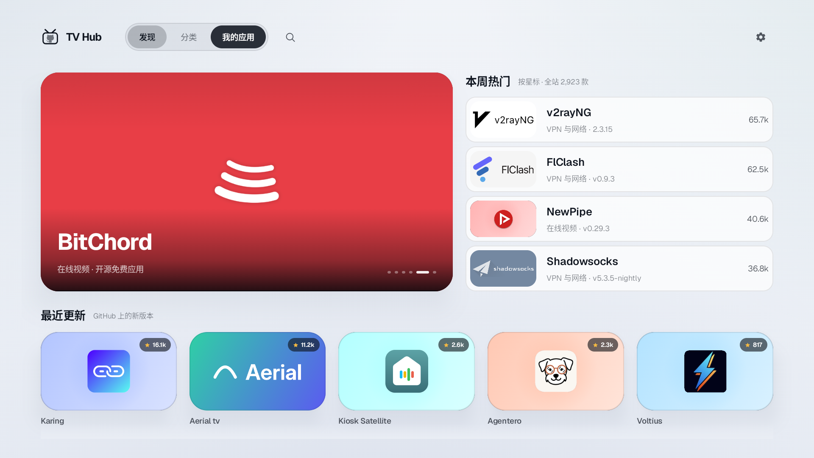
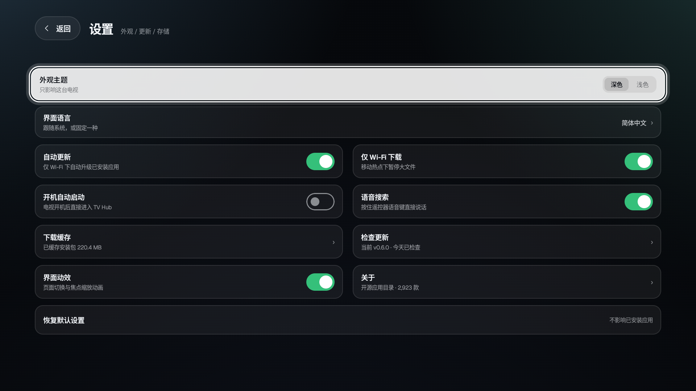

# TV Hub

> **衍生版本 / Derivative work**
> 本仓库是 [Open Shelf](https://github.com/wingedpanther/openshelf)（wingedpanther）的
> **非官方衍生版**（简体中文化、国内下载源、独立品牌），首次修改于 **2026-11-14**，依 **GPL-3.0** 开源。
> 修改清单、版权与第三方资产声明见 [NOTICE.md](NOTICE.md)；本项目与上游无隶属或背书关系。

An app store for Android TV that lists open-source TV apps from GitHub and installs them from each project's releases, using only the remote.

Google Play on TV only carries apps that publish there. Plenty of good TV apps only live on GitHub, where installing one means a phone, a download link and a guess at which APK fits your box. TV Hub does that part for you.

## 项目结构 / Project layout

代码、素材与决策记录都在这个仓库里，克隆下来就是完整的。

| 位置 | 内容 |
|---|---|
| `app/src/main/java/app/tvhub/` | 全部 Kotlin 源码（7 个文件，约 3,300 行）：`Screens.kt` 七个视图、`Ui.kt` 设计系统、`Data.kt` 数据与偏好、`Installer.kt` 下载安装、`Mirror.kt` 国内源、`UpdateIndex.kt` 版本索引 |
| `app/src/main/res/values{,-zh-rCN}/` | 英文基准 + 简体中文文案（各 300+ 条） |
| `docs/screenshots/current/` | 当前界面实拍（深浅主题、设置页） |
| `art/` | 图标源图与生成脚本 |

**先读这三份**：

- [`AGENTS.md`](AGENTS.md) — 项目说明书：硬性约束、代码地图、构建命令、13 个已知坑。**用 AI 工具改代码从这里开始。**
- [`docs/ARCHITECTURE.md`](docs/ARCHITECTURE.md) — 数据怎么流、安装怎么走、本地化怎么实现
- [`docs/DESIGN-SYSTEM.md`](docs/DESIGN-SYSTEM.md) — 1280×720 设计坐标怎么变成 dp、颜色令牌、焦点环、图片羽化

其余：`docs/SCREENS.md`（每个视图的坐标）、`docs/BUILD-AND-TEST.md`（编译 / 模拟器 / 真机 / 截图）、
`docs/DECISIONS.md`（为什么长这样，含被否定的六版设计）、`docs/INTRO.md`（中文项目介绍）。

## What it does

- Lists about 2,900 Android TV apps from GitHub, in 12 top-level categories with 18 sub-categories
- Every app in the list declares TV support in its manifest and ships an APK in its latest release
- Search by name or by what an app does, like "video player" or "launcher"
- Picks the APK that matches your TV's CPU
- Checks the signing key before installing an update, and holds the update if the key changed
- My Apps shows what's installed, with updates for apps in the catalog
- Light and dark themes, and a choice of accent colours
- IPTV players and debrid or Stremio streaming clients are hidden by default, with a switch in Settings to show them
- When an app looks abandoned, its page points to a maintained fork if one ships a newer TV build

## Screenshots

| | |
|---|---|
|  |  |
| Discover (dark) | Discover (light) |



## Install

You need an Android TV, Google TV, Fire TV or other Android box running Android 9 or newer.

1. Download the latest `TVHub-x.y.z.apk` from this repository's Releases.
2. Sideload it with an app like Downloader, or from a computer with `adb install TVHub-x.y.z.apk`.
3. The first time you install an app, Android asks you to allow installs from TV Hub. Allow it once.

## The catalog

The app list is built from public GitHub data and ships inside the APK. An app is included when:

- the repository isn't a fork, unless the original is archived or hasn't had a release in a year, and the fork has at least 10 stars and ships a newer TV build
- its latest release has an APK, published in the last 3 years
- that APK's manifest has the Android TV launcher entry

Apps with fewer than 10 stars stay out of browsing, but search still finds them by their exact name.

## Build

Needs JDK 17 or newer and the Android SDK. Point `local.properties` at the SDK (`sdk.dir=...`), then:

```
./gradlew assembleRelease
```

Release builds are signed with the debug key unless a `keystore.properties` file sits in the project root with `storeFile`, `storePassword`, `keyAlias` and `keyPassword`.

## Translations

All the app's text is in [app/src/main/res/values/strings.xml](app/src/main/res/values/strings.xml). To add a language, copy that file to `values-<code>/strings.xml` (for example `values-de` for German), translate the text and open a pull request.

- Keep placeholders like `%1$s` and `%1$d` as they are. They're filled in with names and numbers.
- `fmt_date`, `fmt_short_date` and `fmt_month_year` are date patterns. German would use `d. MMM yyyy`.
- App descriptions come from each project's GitHub page and stay in English.

## Licence

TV Hub is licensed under the GNU General Public License v3.0. See [LICENSE](LICENSE).

The Geist font is licensed under the SIL Open Font License 1.1. See [FONT-LICENSE-OFL.txt](FONT-LICENSE-OFL.txt).

App names, descriptions and artwork in the catalog belong to their projects.
