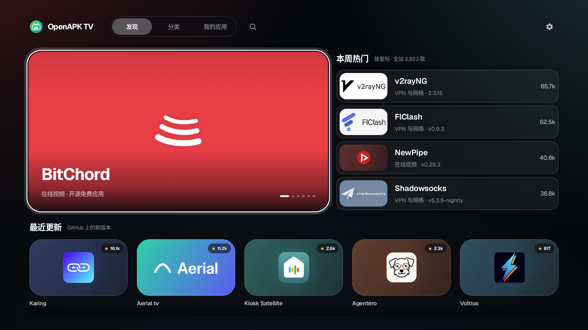
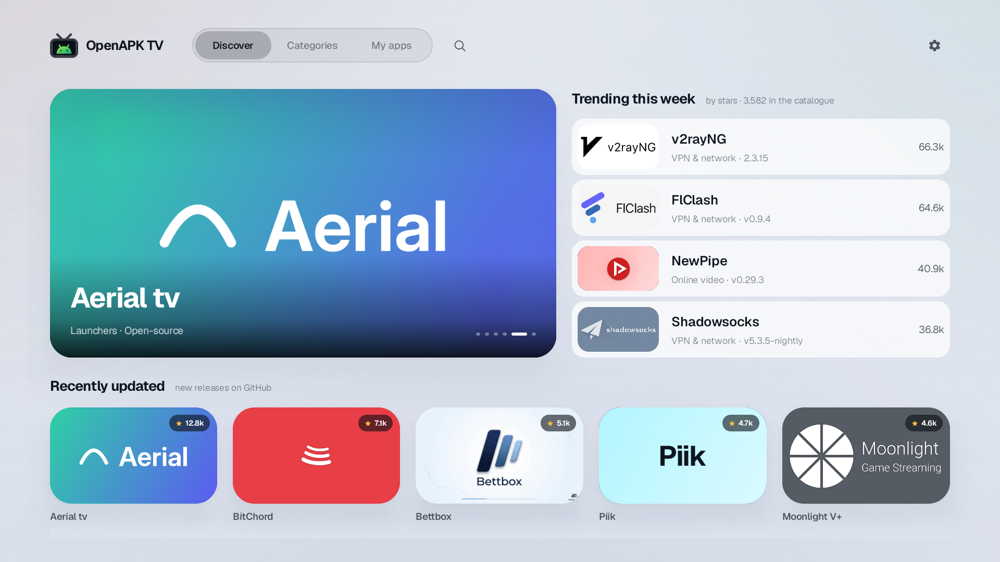

# OpenAPK TV · 项目介绍

> 一个给 Android TV 用的**开源应用商店客户端**：把 GitHub 上只发 Release、不上架商店的电视应用，变成一个能用遥控器翻、能直接装的目录。



## 它是什么

以前在电视上装个开源播放器，得在手机上翻 Releases、猜哪个 APK 对得上你的盒子（`arm64-v8a`？`universal`？）、传文件、装错了重来。

OpenAPK TV 把这一套压成三步：**打开 → 找到 → 按确定**。目录、分类、搜索、架构识别、签名校验、下载安装、更新提示全在电视上完成，不需要手机配合。

## 目录

| | |
|---|---|
| 应用数 | **2,923** |
| 分类 | 12 个一级（影视、音乐、游戏、阅读、桌面、浏览器、AI、系统…）+ 其它，18 个二级 |
| APK 链接 | 4,180 条，全部指向各项目自己的 GitHub Release |
| 收录门槛 | 最新 Release 带 APK、声明 TV 支持、非 fork 或有更新的 fork |
| 数据来源 | 公开 GitHub 元数据，随包内置一份快照 |

分类按用途划分：找「放 NAS 里那些片的播放器」和找「看直播的 IPTV 客户端」是两条路，不会都堆进「视频」。

## 界面

十个英尺外看得清、一只遥控器点得到，是唯一的验收标准。没有鼠标、没有 hover、没有滚动条。

| | |
|---|---|
|  |  |

- **焦点即状态**：静息 / 选中 / 聚焦三态分明，导航与胶囊聚焦时反色实心，卡片用内收焦点环，不做外扩光晕
- **首页按分类成排**：每排先一张「全部」卡（写着这一类的总数），再接四张精选，与分类页数据完全一致
- 深浅双主题、五种强调色、多语言（跟随系统或手动选）
- 可选「仅 Wi-Fi 下载」与「仅 Wi-Fi 自动升级已装应用」

## 安装

需要 Android 9（API 28）以上：Android TV、Google TV、Fire TV、各类带遥控的 Android 盒子。

```bash
adb install TVHub-1.0.0.apk
```

或在电视上用 Downloader 输入 Release 地址。首次安装系统会问是否允许 OpenAPK TV 安装应用，允许一次即可。

## 技术要点

**不是 Leanback 模板套壳**：7 个 Kotlin 文件、七个视图全部在 Compose 里手写。

| 点 | 做法 |
|---|---|
| 设计稿即坐标 | 界面按 1280×720 写死 dp，`DesignCanvas` 用 `LocalDensity` 整体缩放，换分辨率构图不变 |
| 焦点系统 | 自建 `Focusable`，焦点环、反色高亮、焦点记忆与跨区跳转全部手写 |
| 下载源 | `Mirror` 依次尝试 `gh-proxy.com` → `ghproxy.net` → 原链，失败自动换源 |
| 签名校验 | 升级前比对已装包与待装包证书指纹，不一致就拦截，不静默覆盖 |
| 安装不断电 | 安装期间持 `FLAG_KEEP_SCREEN_ON`，系统确认弹窗覆盖时也有效 |

**更新检测**不下载 APK：Actions 每天（热更新的仓库每 6 小时）用 REST 抓各仓库的 `releases/latest`，只凭 tag 判断有没有新版，产出几十 KB 的 `updates.json.gz`；客户端启动 2.5 秒后拉取（带 `If-None-Match`），「我的应用」出现角标、详情页按钮变「更新到 vX」。

检查频率按活跃度自动分层——30 天内发过版的每天查，更久没动的最高 7 天一次；沉寂项目一旦发版会自动升到每天。稳态约 1,900 次请求/天，不需人工维护分类表。

## 数据说明

`catalog.json` 是构建期快照，随 APK 打包，**不是实时爬取**。电视端不该在启动时打几十个 API，也不该因 GitHub 抖一下就白屏；代价是新应用入库需要发版。已收录应用发新版则被每日索引覆盖，不需要更新 APK。

## 许可

本项目是 [Open Shelf](https://github.com/wingedpanther/openshelf) 的**非官方衍生版**，依 **GPL-3.0-only** 发布，首次修改于 2026-11-14。相对上游的实质改动：全量简中化、国内下载源、品牌与图标、界面重做、更新索引链路。详见 [NOTICE.md](../NOTICE.md)。与上游无隶属或背书关系；目录内应用的名称、描述与图标归各自项目所有。

## 参与

- **报问题**：装不上、分类错，开 issue 附应用名即可
- **加语言**：复制 `values/strings.xml` 到 `values-<code>/` 翻译，再在 `Data.kt` 的 `Langs` 表追加一行
- **改代码**：先读 [AGENTS.md](../AGENTS.md)，再看 [ARCHITECTURE.md](ARCHITECTURE.md)
